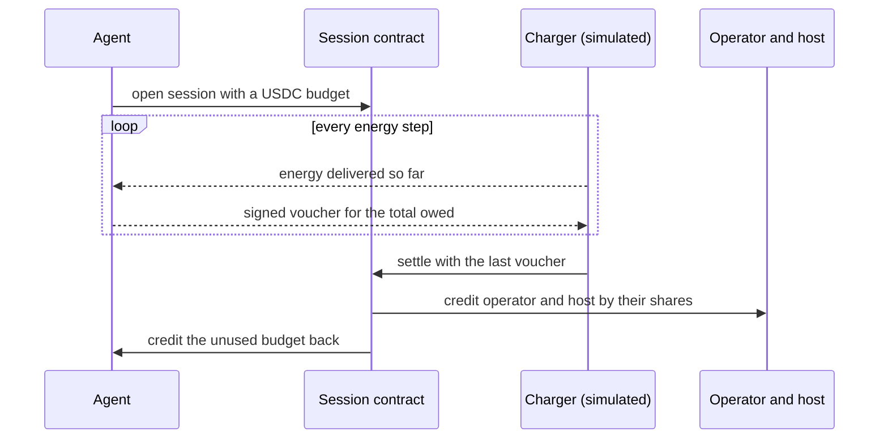

# Arc Charge Agent

Agents that pay for electric vehicle charging per kWh, in USDC, on [Arc](https://www.arc.io/).

A driver or a fleet gives an agent a budget and a few rules: the highest price per kWh it may accept, how much it may spend in one session, which chargers it may use. The agent finds a charger, opens a session and pays as the energy arrives. The operator and the site host each receive their share of every session automatically.

## Status

Idea stage. This repository holds the specification of a first prototype; nothing is built or deployed yet.

| Part | State |
| :- | :- |
| Specification, plan and tasks | Done, in [`specs/001-mvp`](specs/001-mvp) (Portuguese) |
| Contracts (charger registry, session payments) | Not yet |
| Charger simulator | Not yet |
| Paying agent | Not yet |
| Dashboard | Not yet |

The prototype uses a simulated charger. No real hardware and no real funds are involved.

## How it works

The agent only signs for energy it has received, and the charger only keeps delivering while vouchers keep coming. Neither side is exposed to more than one energy step.

## Why Arc

- USDC is the native asset, so one balance pays for both charging and fees, and fees are predictable in dollars.
- Finality in under a second lets a charger act on a settlement right away.
- Arc already carries the building blocks for agents: onchain identity with ERC-8004 and sub-cent payments with Circle Nanopayments.

## Contracts

The contracts are developed with [Arc Studio](https://studio.arc.io/) and deployed to Arc testnet first.

## Author

Manoel Lúcio, Nearxlabs. [GitHub](https://github.com/manucadev81)

## License

MIT
