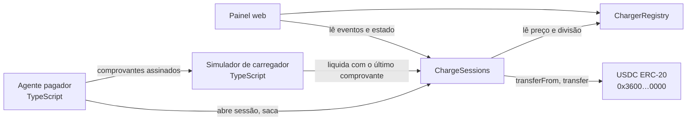

# Arc Charge Agent — Plano técnico (plan.md)

Feature: `001-mvp` · Depende de: `spec.md` · Data: 13/11/2026

## 1. Componentes



| Componente | Onde é feito | Motivo |
| :- | :- | :- |
| `ChargerRegistry` e `ChargeSessions` | Arc Studio | Decisão do autor; o Arc Studio escreve, revisa e publica na testnet |
| Simulador de carregador | Repositório, TypeScript | Não é onchain |
| Agente pagador | Repositório, TypeScript com viem | Não é onchain |
| Painel | Arc Studio ou repositório | O Arc Studio monta interface sobre contrato já publicado |

## 2. Contratos

### ChargerRegistry

```solidity
struct Charger {
    address operator;
    address host;
    uint16 hostShareBps;
    uint64 pricePerKwh;
    bool active;
}

function register(address host, uint16 hostShareBps, uint64 pricePerKwh) external returns (uint256 chargerId);
function setPrice(uint256 chargerId, uint64 pricePerKwh) external;
function setActive(uint256 chargerId, bool active) external;
function getCharger(uint256 chargerId) external view returns (Charger memory);
```

`pricePerKwh` em unidades de USDC com 6 casas. Só o operador altera o próprio carregador.

### ChargeSessions

```solidity
function open(
    uint256 chargerId,
    address agentSigner,
    uint256 budget,
    uint64 maxPricePerKwh,
    uint64 expiry
) external returns (uint256 sessionId);

function settle(
    uint256 sessionId,
    uint64 cumulativeWh,
    uint256 cumulativeAmount,
    bytes calldata signature
) external;

function reclaim(uint256 sessionId) external;
function withdraw() external returns (uint256 amount);
```

Regras:
- `open` puxa `budget` do pagador, exige carregador ativo e preço do cadastro menor ou igual a `maxPricePerKwh`, e trava esse preço na sessão.
- `settle` só pelo operador do carregador, antes de `expiry`. Confere a assinatura EIP-712 de `agentSigner` sobre `(sessionId, cumulativeWh, cumulativeAmount)`, exige `cumulativeAmount <= budget` e `cumulativeAmount <= cumulativeWh * preço / 1000`.
- A divisão credita o dono do local com `cumulativeAmount * hostShareBps / 10000`, o operador com o restante e o pagador com `budget - cumulativeAmount`.
- `reclaim` só pelo pagador, depois de `expiry`, se a sessão não foi liquidada.
- Créditos saem por `withdraw`.

Eventos: `ChargerRegistered`, `PriceChanged`, `SessionOpened`, `SessionSettled`, `SessionReclaimed`, `Withdrawn`.

## 3. Fluxo fora da rede

1. O agente lê o cadastro, filtra por regras e escolhe o carregador mais barato.
2. Abre a sessão e informa o `sessionId` ao simulador.
3. A cada etapa, o simulador informa a energia acumulada; o agente confere, assina o comprovante acumulado e envia.
4. O simulador guarda só o comprovante mais recente.
5. Ao atingir a energia desejada ou o orçamento, o agente encerra; o simulador liquida.
6. Operador, dono do local e pagador sacam.

## 4. Decisão: comprovantes próprios agora, Nanopayments depois

| Opção | A favor | Contra |
| :- | :- | :- |
| Comprovantes assinados e contrato próprio (escolhida para o MVP) | Sem credenciais externas; contrato feito no Arc Studio; fluxo auditável | Não usa um produto Circle além do USDC |
| Circle Nanopayments com x402 | Usa produto Circle, o que pesa em grants; pagamentos a partir de US$ 0,000001 | Exige conta e chaves no Circle Console; menos contrato próprio |

A fase 2 troca o transporte dos pagamentos por Nanopayments mantendo cadastro e divisão.

## 5. Testes

| Camada | Cobertura |
| :- | :- |
| Contratos | Unitários, fuzz da divisão e invariante "soma dos créditos igual ao orçamento" (SC-002) |
| Assinaturas | Comprovante válido, assinante errado, sessão errada, valor acima do orçamento, valor incoerente com a energia |
| Prazos | Liquidação depois do prazo recusada; recuperação antes do prazo recusada |
| Rede | `arc-forge test` e uma execução contra a testnet com o endereço bloqueado de teste |
| Agente e simulador | Sessão completa e os três cenários de falha (SC-003) |
| Verificação estática | Arc Porter sem achado alto (SC-004) |

O código gerado pelo Arc Studio é revisado e testado no repositório antes de ser considerado pronto.

## 6. Riscos

| Risco | Mitigação |
| :- | :- |
| Código gerado com falha de segurança | Revisão do squad, testes próprios e Arc Porter antes de qualquer uso |
| Limites de uso do Arc Studio | Prompts curtos, um contrato por vez, plano antes de código |
| Carteiras de contrato não assinam como carteira comum | MVP usa chave comum para o agente; suporte a ERC-1271 fica para depois |
| Projeto parecer pronto para uso real | README e painel dizem "simulado" e "testnet" |

## 7. Fases

| Fase | Entrega | Onde |
| :- | :- | :- |
| A | `ChargerRegistry` e `ChargeSessions` escritos, revisados e publicados na testnet | Arc Studio |
| B | Código dos contratos no repositório com testes próprios e invariantes | Repositório |
| C | Simulador e agente com sessão completa e cenários de falha | Repositório |
| D | Painel | Arc Studio ou repositório |
| E | Fase 2: Nanopayments e identidade ERC-8004 | A decidir |

Estimativa do autor da spec, para uma pessoa: A 2 dias, B 2 dias, C 3 dias, D 2 dias.
